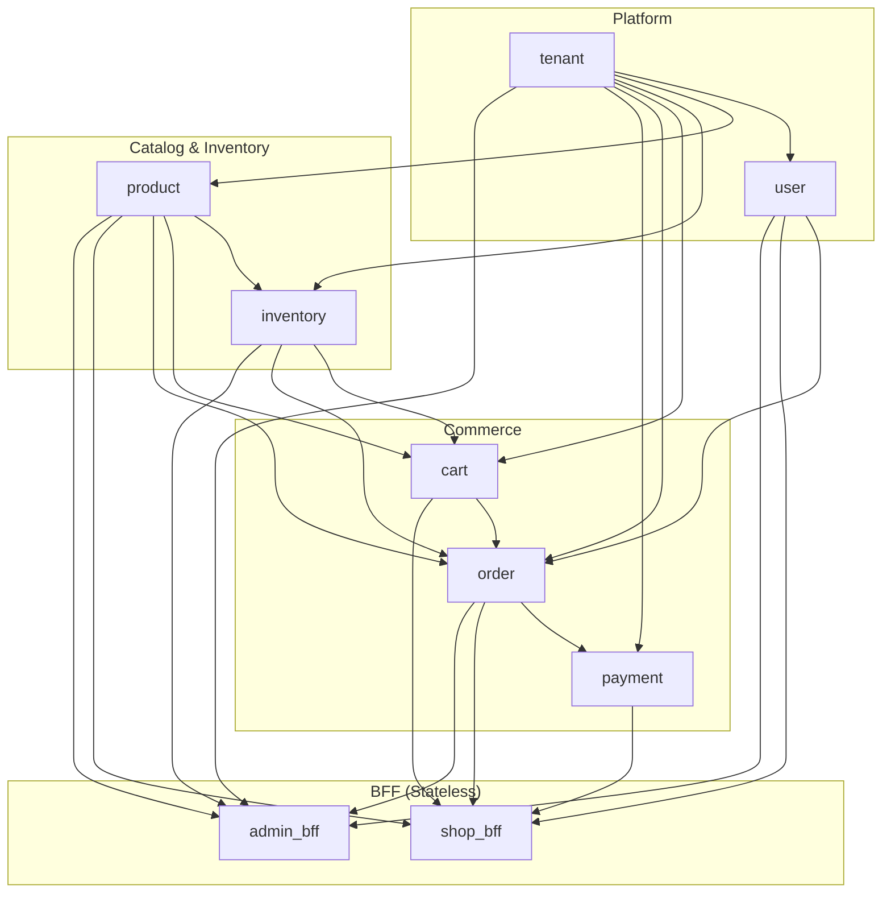

# Multi-Tenant Store Blueprint (Modulith)

This blueprint defines the module dependency graph, event flows, and directory layout for a multi-tenant e-commerce application built on zmodu.

Reference implementations:
- [`examples/tenant-mgmt/`](../../examples/tenant-mgmt/): Platform tenant, user, and subscription modules.
- [`examples/tenant-shop/`](../../examples/tenant-shop/): Full commerce workflow (catalog, inventory, cart, order, payment, and transactional outbox).

## 1. Architecture Overview

| Aspect | Convention |
|--------|------------|
| Deployment | Single binary, horizontally scaled across stateless instances |
| Tenant isolation | Row-level `tenant_id` column + JWT `aud` claim + middleware |
| Entry points | `shop_bff` (storefront API) and `admin_bff` (merchant admin API) |
| Synchronous writes | `order` service coordinates `inventory`, `cart`, and `product` via `persistence.Tx` |
| Async side effects | Transactional outbox → Kafka/RobustMQ (`order.created`, `payment.succeeded`, `inventory.stock_low`) |

## 2. Module Dependency Graph

### 2.1 Synchronous Dependencies (`info.dependencies`)

Arrows point from dependency to dependent (`A --> B` means `B` declares `A` in `info.dependencies`):



### 2.2 Module Declarations

| Module | `dependencies` | Responsibility |
|--------|----------------|----------------|
| `tenant` | `{}` | Tenant CRUD, status, and subscription tier |
| `user` | `{tenant}` | Customers and staff scoped by `tenant_id` |
| `product` | `{tenant}` | SPU/SKU catalog and pricing |
| `inventory` | `{tenant, product}` | Stock levels, reservation, and release |
| `cart` | `{tenant, product, inventory}` | Customer shopping cart |
| `order` | `{tenant, user, product, inventory, cart}` | Checkout transaction, order state machine, outbox writes |
| `payment` | `{tenant, order}` | Payment intents, webhook callbacks, reconciliation |
| `shop_bff` | `{user, product, cart, order, payment}` | Storefront HTTP routes |
| `admin_bff` | `{tenant, user, product, inventory, order}` | Merchant admin HTTP routes |

### 2.3 Asynchronous Events

| Event Topic | Publisher | Subscribers | Action |
|-------------|-----------|-------------|--------|
| `order.created` | `order` | `inventory`, `payment` | Confirm reservation, initialize payment intent |
| `payment.succeeded` | `payment` | `order` | Transition order status to `paid` |
| `payment.failed` | `payment` | `order`, `inventory` | Cancel order and release reserved stock |
| `inventory.stock_low` | `inventory` | `admin_bff` | Emit low-stock alert |

All event payloads include `tenant_id` and an idempotency key so consumers can safely retry.

## 3. Request Middleware Pipeline

```text
HTTP Request
  -> recover / requestId / rateLimit
  -> catalog JWT authentication (extracts `user_id` from `sub`, `tenant_id` from `aud`)
  -> moduleGate + permissionGateWith(.rbac)
  -> shop_bff | admin_bff | domain api handler
  -> service (passes `tenant_id` explicitly)
  -> persistence (`WHERE tenant_id = ?`)
```

## 4. Directory Layout

```text
tenant-shop/
├── build.zig
├── build.zig.zon
├── init.sql
└── src/
    ├── main.zig
    ├── config.zig
    ├── foundation/
    │   ├── db.zig
    │   ├── redis.zig
    │   ├── mq.zig
    │   └── outbox.zig
    ├── business/
    │   └── enums.zig
    └── modules/
        ├── tenant/       # module.zig, model.zig, persistence.zig, service.zig, api.zig, root.zig
        ├── user/
        ├── product/
        ├── inventory/
        ├── cart/
        ├── order/
        ├── payment/
        ├── shop_bff/     # module.zig, service.zig, api.zig, root.zig (no persistence.zig)
        └── admin_bff/    # module.zig, service.zig, api.zig, root.zig (no persistence.zig)
```

## 5. Bootstrap Sequence (`src/main.zig`)

```zig
var b = zmodu.builder(allocator, io);
defer b.deinit();
var app = try b.withName("tenant-shop")
    .build(.{
        tenant.Module,
        user.Module,
        product.Module,
        inventory.Module,
        cart.Module,
        order.Module,
        payment.Module,
        shop_bff.Module,
        admin_bff.Module,
    });
defer app.deinit();

try app.start();
defer app.stop();
```

## 6. Database Schema Conventions

| Table | Required Columns | Notes |
|-------|------------------|-------|
| `tenants` | `id`, `status`, `tier` | Platform root table (no `tenant_id` column) |
| `users` | `id`, `tenant_id`, ... | Staff and customer accounts |
| `products` | `id`, `tenant_id`, `price_cents`, ... | Catalog items |
| `inventory` | `tenant_id`, `sku_id`, `qty`, `reserved` | Stock tracking |
| `carts` / `cart_items` | `tenant_id`, `user_id`, ... | Active carts |
| `orders` / `order_items` | `id`, `tenant_id`, `user_id`, `status` | Order records |
| `payments` | `id`, `tenant_id`, `order_id`, `idempotency_key` | Idempotent payment records |
| `outbox` | `id`, `tenant_id`, `topic`, `payload`, `status` | Transactional event outbox |
